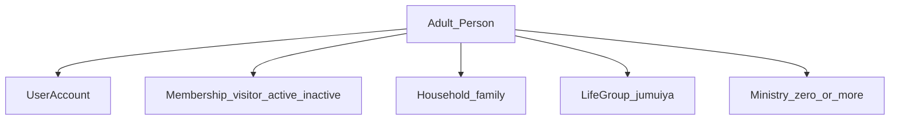

# Conceptual Domain Model

**Status:** Working MVP baseline (2026-11-07)  
**This is a conceptual model, not a migration-ready schema.**  
**Detail:** `04_LOGICAL_ENTITY_CATALOG.md`, `08_ERD.md`, `03_DATA_PHILOSOPHY.md`

## 0. Product surfaces

One shared domain powers:
1. **Church administration**
2. **Member portal**

Access differs by RBAC (`11_RBAC_AND_PERMISSIONS.md`). A future **social/community app** consumes stable IDs via API only (`05_SOCIAL_EXTENSION_MAP.md`).

**Person identity:** global `Person`; church relationship via membership / organisation user (OQ-020 decided).

## 0.1 Member profile composition (MVP)

A **member profile** is not one table. It is assembled from:

| Layer | What it answers | Model |
|---|---|---|
| 1. Individual adult | Who is this person? | `Person` + contacts + photo + locale + directory opt-in |
| 2. Account | Can they sign in to the portal? | Every **adult** member has a `UserAccount` linked via `OrganisationUser` |
| 3. Membership | Are they visitor / active / inactive in this church? | `Membership` (individual registration of each adult) |
| 4. Household / family | Who is their family (married, with or without children)? | `Household` + `HouseholdMember`; optional `HouseholdChild` (name + age) |
| 5. Life group / jumuiya | Which small group do they belong to? | `Participation` in `OrganisationalUnit.kind = life_group` (same idea: small group, life group, jumuiya) |
| 6. Ministry | Are they in one or more ministries? | `Participation` in `OrganisationalUnit.kind = ministry` (multi allowed; may be none) |

**Rules**
- Register **each person 18+ individually** (own Person + Membership + portal account).
- **Age** (DEC-029; prefer DOB → age): **under 18** → `HouseholdChild` (name + age only); **18+** → Person + Membership + `UserAccount`. MVP uses this single cutoff (finer youth bands later if needed).
- Under-18s can still be part of **main masses** (e.g. counted in headcount) without a full member profile. Children’s ministry module remains **out of MVP**.
- Household links adults (e.g. married) and optional under-18 children.
- Life group and ministry are **separate** participations — a member may have a life group and zero or more ministries.
- Department/office is admin structure, not a required member-profile layer.

## 1. Organisation and tenancy

- **Church** — tenant identity.
- **ChurchSettings** — locale (EN/SW), timezone, operational flags.
- **OrganisationalUnit** — `department` (alias office) | `ministry` | **`life_group`** (small group / life group / jumuiya — same idea).
- **Programme** — what a ministry delivers.
- **OrganisationUser** — login account membership in a church (links `UserAccount` ↔ church ↔ `Person`).

No branch hierarchy in MVP.

## 2. People and households

- **UserAccount** — authentication identity; **required for every adult member** who uses the portal.
- **Person** — human known to the platform (global).
- **PersonContact** — phone/email channels.
- **Household** — family grouping with shared address + emergency contact; with or without children; **optional** for a solitary adult with no dependants.
- **Household label (name)** — human display only (DEC-030): suggest from adults (e.g. “Kyamba Family”, “Neema Mushi Household”); editable; **not unique** (last names are commonly shared). Unique id = `household.id` (UUID).
- **HouseholdMember** — adult person ↔ household (relationship: spouse, parent, guardian, etc.).
- **HouseholdChild** — name + age only for under-18s (not Person/account/membership).
- **Single parent / guardian:** one adult member + children; no spouse required; do not invent a missing partner.
- **ConsentRecord** / **CommunicationPreference** — consent and channel opt-in.
- **MediaAsset** — profile photo / attachment metadata.

Visitors may exist as Person + Membership(`visitor`) before an account is issued. Full minor/guardian portal remains deferred.

## 3. Membership

- **Membership** — type `individual` | `household` | `family`; status `visitor` | `active` | `inactive`.
- **MembershipApplication** / **MembershipDecision** — formal approval by pastoral leadership + Administrator + GS/POGS.
- **MembershipStatusHistory** — append-only status changes.

## 4. Governance and leadership

- **Position** / **Appointment** / **AppointmentHistory** — effective-dated; Senior Pastor appoints/removes.
- Pastoral leadership = church pastors (not a separate “Pastoral Board” entity); optional **Board of Elders** as configurable governance body for other churches.
- Title/appointment does **not** auto-create software roles.
- **Delegation** — temporary SP powers to Associate Pastor (or designate) while away (DEC-033); see `13_ANNOUNCEMENTS_AND_DELEGATION.md`.
- **Approvals** — `12_APPROVAL_MATRIX.md`. **Reports** — `14_LEADERSHIP_REPORT_CATALOGUE.md`.

## 5. Units and participation

- **ParticipationRequest** / **Participation** / **ParticipationHistory** — many-to-many.
- Apply to **ministry** and **life_group** (jumuiya) units; multi-ministry allowed; life group typically 0–1 current (policy may allow more).
- Ministry/life-group leaders approve joins for their unit; pastoral leadership receives notification/report.
- **Project** / **ProjectAssignment** — time-bound (or ongoing) goals; may link to fund/budget.

## 6. Events and attendance (DEC-031)

- **EventType** / **Event** / **EventRegistration** — registration ≠ attendance.
- **AttendanceSession** — per service/session; mode `headcount` | `roll_call` | `qr_mixed` (named check-ins + optional headcount supplement).
- **AttendanceRecord** — named presence for a **Person** (not required to have UserAccount); source `qr` | `roll_call` | `manual`; may store check-in **name + phone** as captured.
- **AttendanceSummary** — headcount breakdowns (men/women/children/visitors/total) where used.
- **SessionQr / PersonAttendanceQr** — signed QR tokens for check-in. **Guest QR path:** no account → scan session QR → enter **name + phone** → match or create visitor Person → record.
- **AttendanceDayAggregate** — rolls up multiple sessions (e.g. several Sunday services) into totals + statistical breakdowns.
- **AbsenceNotice** — cannot attend (e.g. Sunday); reason; admin notified; part of tracking.
- **Family attendance view** — household-level picture derived from adult check-ins + children’s ministry headcount / household children.
- **Progress & encouragement** (account holders) — calendar progress, attendance grade/progress band, remind / encourage / congratulate notifications (not punitive scoring).
- **Leadership stats** — individual progress breakdowns for follow-up/help (scoped permissions).
- **Children’s ministry headcount** — when that unit exists, recorded only by accepted ministry leaders/teachers.

## 7. Accounting, offerings, pledges

- **Fund**, **Account** (chart of accounts), **FiscalPeriod**.
- **JournalEntry** / **JournalLine** — double-entry; posted immutable; reverse to correct.
- **DisbursementRequest** / **ApprovalRecord** — dual control (writers ≠ sole approvers).
- **Budget** / **BudgetLine**.
- **Pledge** / **PledgeApplication** / **PledgeFollowUp** — pledges vs actual.
- Payment **method** may include mobile money; live gateway deferred.
- Admin only — never member portal.

## 8. Communication and import

- **Announcement** / **AnnouncementAudience**.
- **MessageTemplate** / **MessageJob** / **MessageDelivery** — SMS + WhatsApp; visitor thank-you trigger.
- **ImportJob** / **ImportRowResult** — Excel member import (admin).

## 9. Security and audit

- **Role**, **Permission**, **RolePermission**, **UserRoleAssignment** (+ scope).
- **AuditEvent** (append-only), **IdempotencyKey**, **DomainEventOutbox**.

## 10. Key relationships

- Church 1—many tenant-owned records.
- Person global; many Memberships across churches over time.
- Person many—many Household via HouseholdMember.
- Unit many—many Person via Participation.
- Event 1—many registrations and attendance sessions.
- JournalEntry 1—many JournalLines (balanced).
- Project optionally links Fund/Budget.

## 11. Future social boundary

Do not add feed, friendship, DM, reaction, or story entities in MVP. Preserve stable Person, Unit, Event, Project, Consent, MediaAsset IDs for API integration.

## 12. Explicitly deferred

Full children’s safeguarding/check-in suite (beyond ministry headcount) · mobile-money gateway · payroll/HR · pastoral-care note store · social graph.
