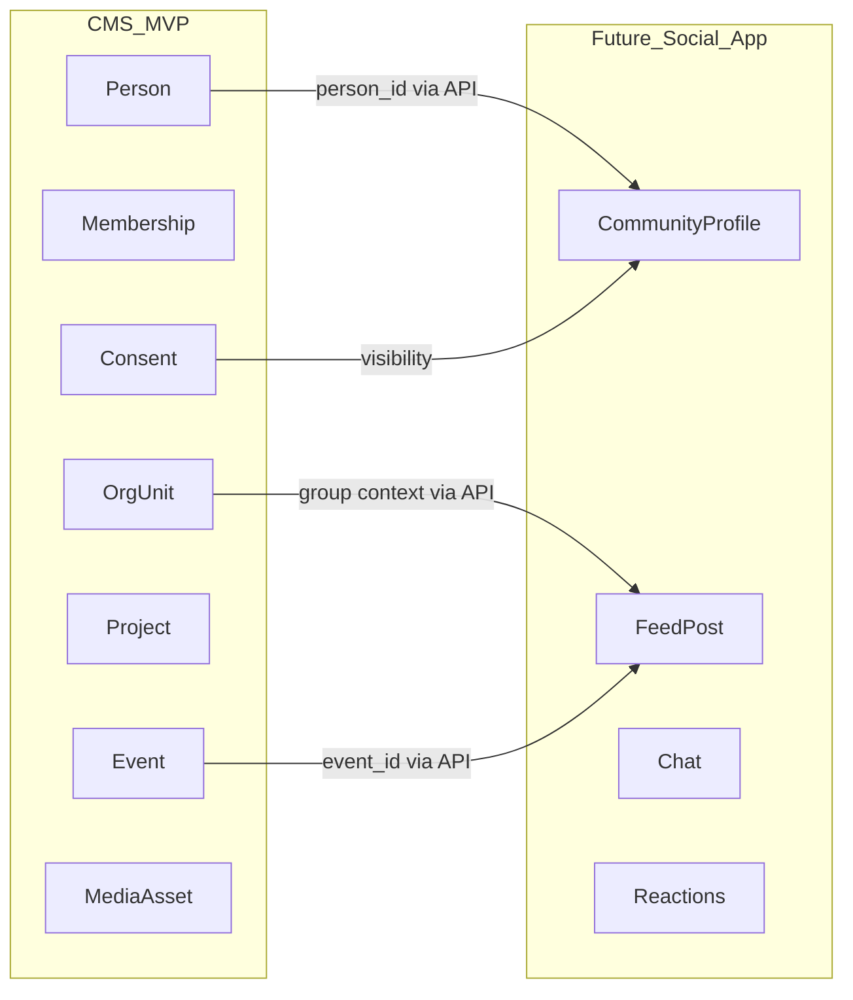

# 05 — Social Extension Map

**Status:** Reserved future product boundary (not MVP implementation)  
**Decision:** DEC-005 — social/community app deferred; preserve integration foundations.

## 1. Rule

Do **not** create feed, friendship, DM, reaction, story, or comment tables in the MVP schema.  
Do design MVP entities so a future social app can reference them by **stable ID via `/api/v1`**, without sharing the database.

## 2. MVP seams that must stay stable

| Seam | Why social needs it |
|---|---|
| Global `Person` + `UserAccount` | One identity across CMS and community |
| Church tenancy | Isolate communities per church |
| Membership status | Gate who may join social features |
| Ministry / unit participation | Group membership foundation |
| Event + Project IDs | Attach posts/check-ins to church life |
| Consent + CommunicationPreference + directory_opt_in | Deny-by-default visibility |
| Notification abstraction | Social notifications later |
| MediaAsset metadata | Profile photo / later media |
| DomainEventOutbox | `people.person.updated`, `membership.member.activated`, etc. |
| Scoped OAuth / API clients | Social app gets least-privilege scopes |

## 3. Member profile ≠ community profile

| MVP (CMS) | Future (Social) |
|---|---|
| Operational person + directory opt-in | `CommunityProfile` (handle, bio, social visibility) |
| Church membership | Social eligibility derived from membership via API |
| Ministry participation | Optional group feeds |

Do not overload Membership rows with social bio fields.

## 4. Reserved future entities (document only)

- CommunityProfile  
- Post / FeedItem  
- Comment  
- Reaction  
- Friendship / Follow  
- Conversation / Message  
- Story  
- ModerationAction  
- Social-specific notification preferences  

## 5. Anti-patterns

- Shared Neon database between CMS and social deployables  
- Social tables “temporarily” added to MVP migrations  
- Returning Restricted CMS fields (giving, pastoral, phones) to social clients  
- Using Server Actions in CMS for social business ops  

## 6. Design checklist (when touching MVP entities)

Ask: *Can the social app reference this by stable ID without reading our tables?*  
If yes, keep the API/DTO boundary clean. If the change would force social to join CMS tables, stop and redesign.
