# 08 — Entity-Relationship Diagrams (Logical)

**Status:** Working baseline for MVP data design  
**Date:** 2026-11-07  
**Not:** physical Drizzle/SQL schema or migrations  

**Surfaces:** Church administration + Member portal share these entities; access differs by RBAC.  
**Identity:** `Person` is **global**; church link is via membership / org-user (OQ-020 → global).  
**CrossLife:** mock/fixtures only — no production seed (DEC-023).

Conventions:
- Every **church-owned** entity includes `church_id` (omitted from diagrams for readability unless central).
- Standard columns on most tables: `id` (UUIDv7), `created_at`, `updated_at`, `created_by`, `updated_by`; soft-archive `deleted_at` where policy says.
- Money: `amount_minor` bigint + `currency` (default `TZS`).
- History/correction: prefer append-only history or reversing entries — see algorithms doc (forthcoming).

---

## 1. Tenancy, auth, RBAC

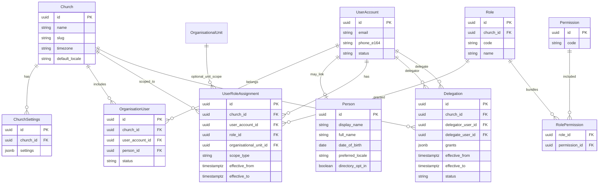

**Notes**
- `Permission.code` is global/stable (`people:read`, `journals:post`, …).
- `Role` is per-church (labels configurable); seed role codes documented in RBAC pack.
- Appointment / public title does **not** create `UserRoleAssignment`.
- `Delegation` = temporary SP powers (DEC-033); see `13_ANNOUNCEMENTS_AND_DELEGATION.md`.

---

## 2. People, contacts, households

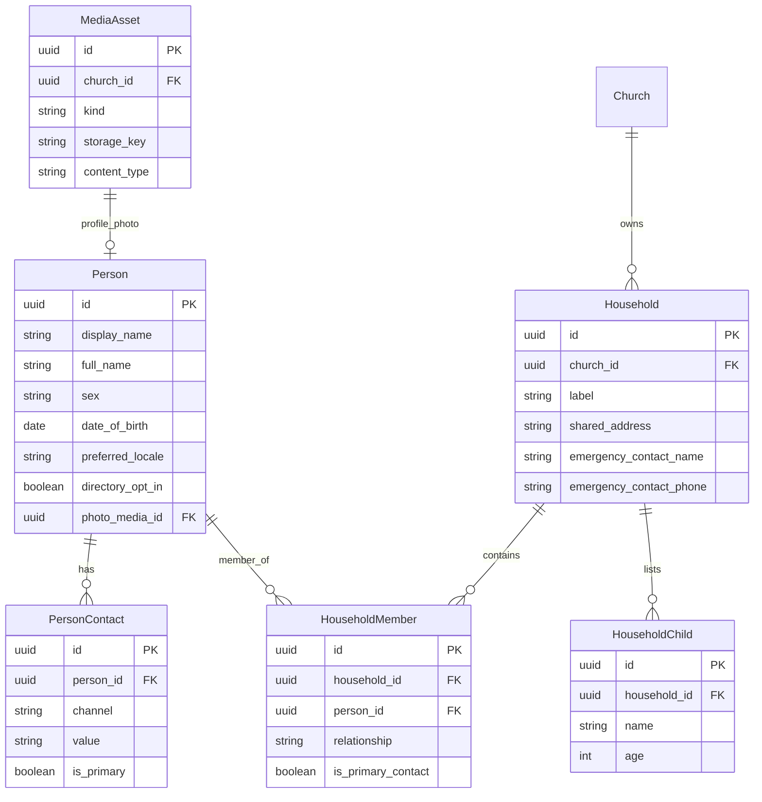

**Notes**
- `HouseholdChild`: **name + age only** — not a `Person`, no login (DEC-016).
- Full minor/guardian membership **deferred**.
- Contacts stored separately; phones E.164.

---

## 3. Membership lifecycle

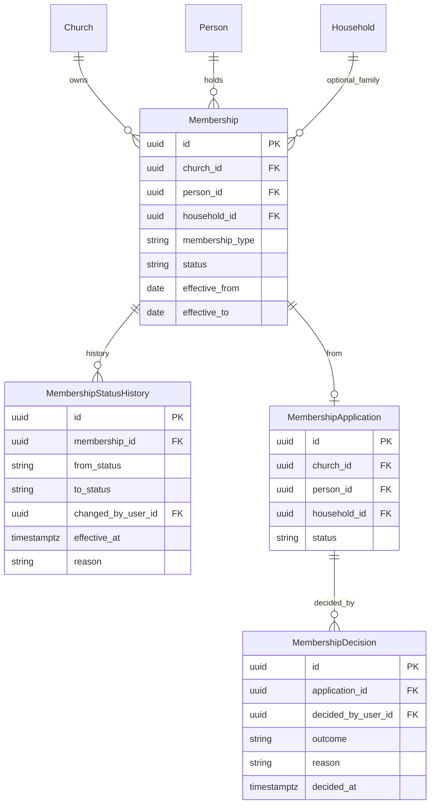

**Notes**
- `membership_type`: `individual` | `household` | `family` (DEC-012).
- `status`: `visitor` | `active` | `inactive` (DEC-012).
- Approval actors: pastoral leadership + Administrator + GS/POGS.
- Status changes append `MembershipStatusHistory` (no silent overwrite).

---

## 4. Organisation: units, programmes, positions, appointments

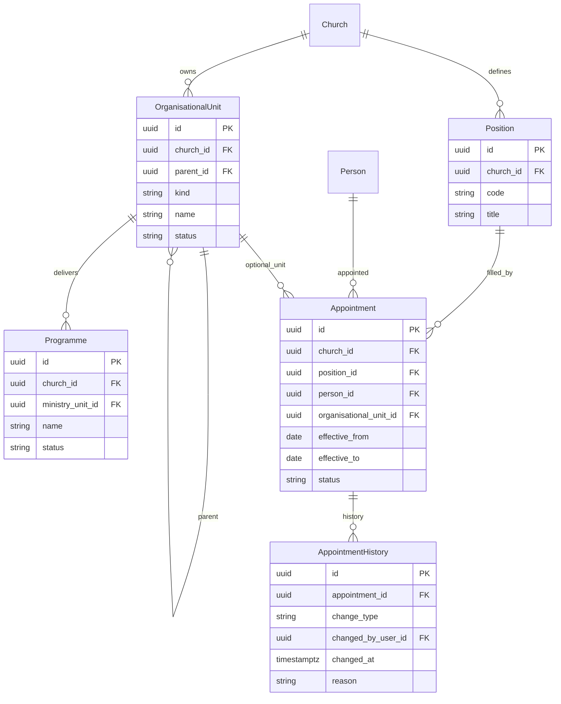

**Notes**
- `OrganisationalUnit.kind`: `department` (alias office) | `ministry` | **`life_group`** (small group / life group / jumuiya — same concept).
- Programme belongs to a **ministry** unit (DEC-011).
- Member profile layers: adult Person + account + membership + household + optional life_group participation + zero-or-more ministry participations.
- Senior Pastor appoints/removes leaders (DEC-008); appointments are effective-dated + history.

---

## 5. Ministry participation

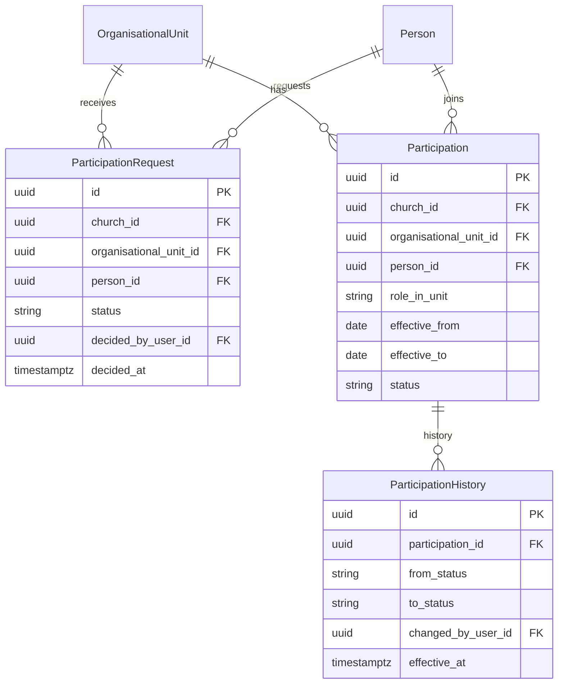

**Notes**
- Many-to-many: one person → many ministries (DEC-022).
- Approve: **that ministry’s leaders**; pastoral leadership gets notification/report (DEC-017).
- Typically `organisational_unit.kind = ministry`.

---

## 6. Events and attendance (DEC-031)

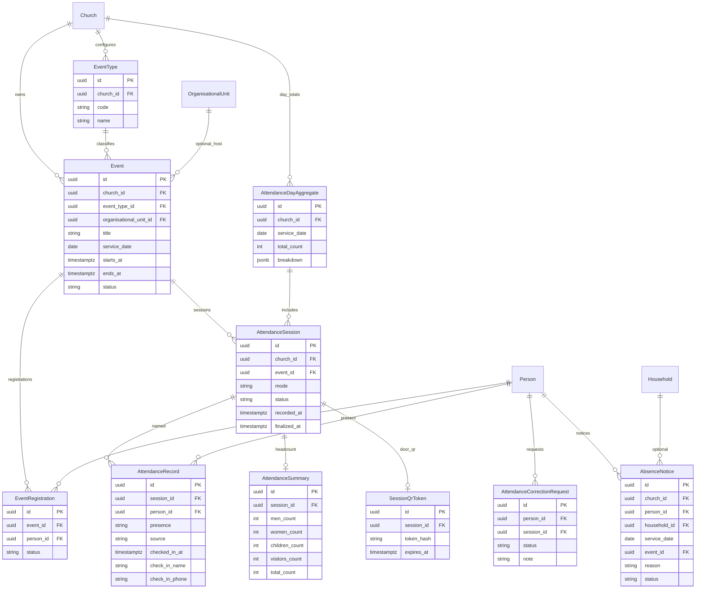

**Notes**
- Registration ≠ attendance. Named attendance keys off **Person**, not UserAccount.
- Modes: `headcount` | `roll_call` | `qr_mixed` (DEC-031). QR source on `AttendanceRecord.source`.
- Multiple Sunday services → multiple sessions → **AttendanceDayAggregate**.
- Absence notices feed admin tracking; family views join household + records + children’s headcount.
- Children’s ministry sessions: headcount; only accepted unit leaders/teachers may record.

---

## 7. Projects

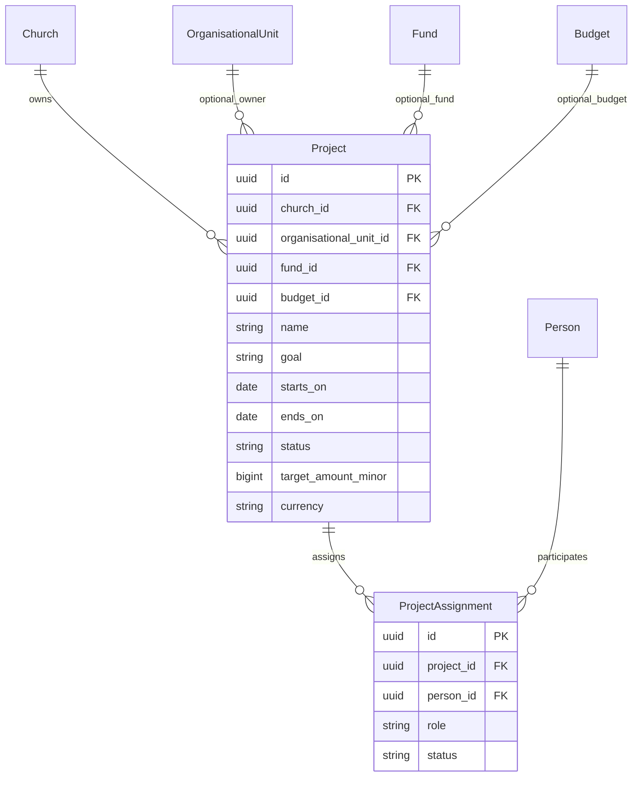

**Notes**
- Projects are time-bound (or ongoing) goal activities; may be money-linked (DEC-020).
- Distinct from ministry **programmes**.

---

## 8. Accounting, offerings, pledges

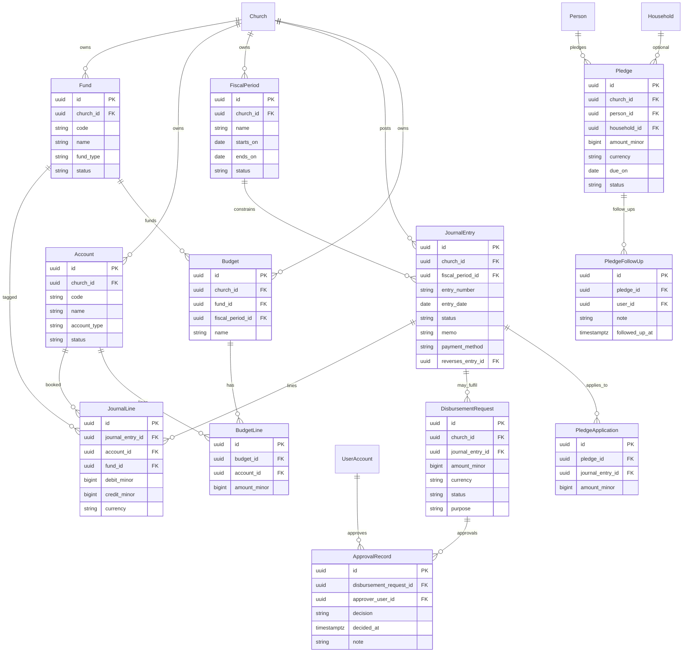

**Notes**
- Double-entry: Σ debits = Σ credits per posted entry; posted entries immutable — reverse to correct.
- `payment_method` includes `cash` | `mobile_money` | `bank` | … — **no live wallet gateway** yet.
- Finance writers ≠ sole approvers for disbursements (DEC-013).
- Member portal: **no** finance/pledge admin access.
- Offering types map to income `Account`s (and/or fund tags), not a separate social product.

---

## 9. Messaging, announcements, consent

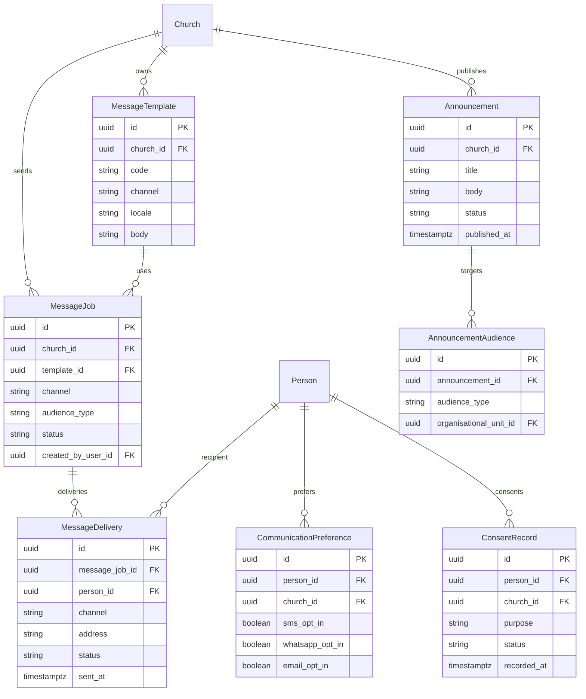

**Notes**
- Channels in MVP: **SMS** + **WhatsApp** (email optional later).
- Visitor thank-you: template + job triggered on visitor registration (consent-aware).
- No send without permitted preference/consent.

---

## 10. Import jobs

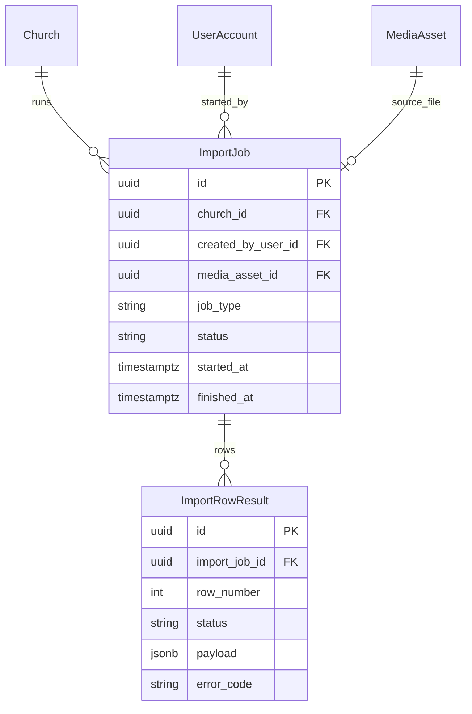

**Notes**
- Admin-only; `job_type` e.g. `members_excel`.
- Flow: upload → validate → preview → commit; dedupe on phone/email within church.

---

## 11. Audit and idempotency

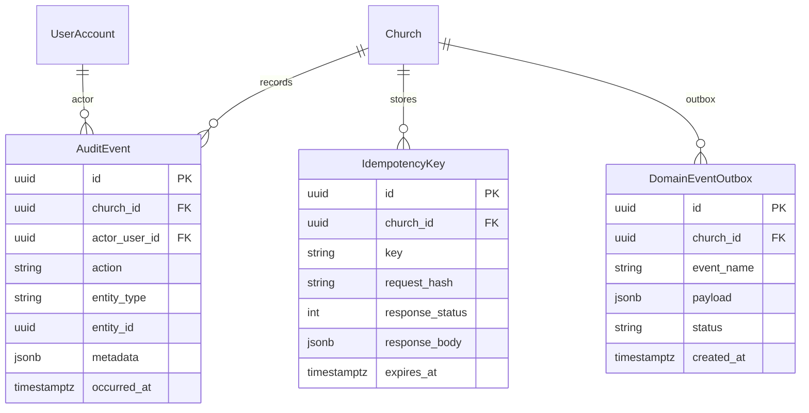

**Notes**
- `AuditEvent` is **append-only** (never update/delete).
- Outbox holds domain events for future social/webhooks; delivery later.
- Idempotency required for registrations, imports, message sends, journal posts, disbursements.

---

## 12. Cross-context overview

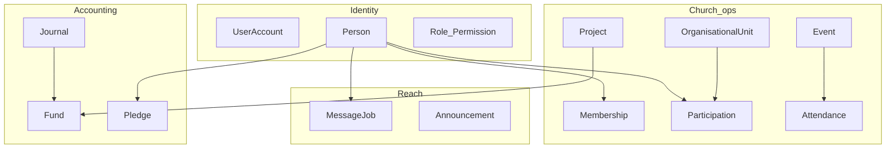

---

## 13. Explicitly not on these ERDs (deferred)

- Branch / campus hierarchy  
- Full children’s safeguarding/check-in suite beyond headcount  
- Social graph (posts, friends, DMs, reactions, stories)  
- Mobile-money gateway / webhook settlement tables  
- Pastoral-care note store  

Future social app references `Person`, units, events, projects, consent via **API**, not shared tables — see forthcoming social extension map.

---

## 14. Related documents

| Doc | Purpose |
|---|---|
| `03_DATA_PHILOSOPHY.md` | Binding modelling principles |
| `04_LOGICAL_ENTITY_CATALOG.md` | Attributes, uniqueness, mutability per entity |
| `05_SOCIAL_EXTENSION_MAP.md` | Future social seams (no MVP tables) |
| `06_ACCOUNTING_MODULE.md` | Accounting / pledges specification |
| `07_MESSAGING_MODULE.md` | SMS / WhatsApp specification |
| `09_DOMAIN_LOGIC_AND_ALGORITHMS.md` | State machines + service algorithms |
| `10_API_ENDPOINT_MAP.md` | `/api/v1` routes citing permissions |
| `11_RBAC_AND_PERMISSIONS.md` | Roles × permissions × scopes |
