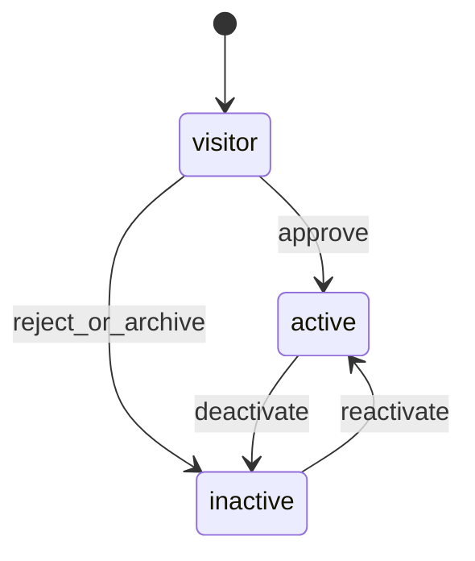

# 09 — Domain Logic and Algorithms

**Status:** Working baseline (MVP)  
**Companions:** `08_ERD.md`, `04_LOGICAL_ENTITY_CATALOG.md`, `11_RBAC_AND_PERMISSIONS.md`  
**Use:** Implement as service functions; keep handlers thin.

Every algorithm assumes `Ctx { actor, churchId, requestId, locale }` and starts with permission checks.

---

## 0. Shared: tenant-scoped access

```
function loadChurchOwned(repo, ctx, id):
  row = repo.findById(id)
  if row is null OR row.church_id != ctx.churchId:
    raise NotFoundError
  return row
```

Never leak other-tenant existence (404 not 403).

---

## 1. Membership approve / reject

**Actors:** `senior_pastor` | `pastoral_leadership` | `church_administrator` | `pogs`  
**Permission:** `memberships:approve`

**States (Membership.status):** `visitor` → `active` ↔ `inactive`



**Algorithm — approve application**
1. `can(ctx, 'memberships:approve')` else Forbidden  
2. Load `MembershipApplication` (tenant-scoped); status must be `pending`  
3. In transaction:  
   a. Insert `MembershipDecision(outcome=approved)`  
   b. Upsert `Membership` type from application; set status `active`; set effective_from  
   c. Append `MembershipStatusHistory`  
   d. Mark application `approved`  
   e. Write `AuditEvent` + outbox `membership.member.activated`  
4. Commit  

**Reject:** same with outcome `rejected`, membership may stay `visitor` or become `inactive` per policy.

**Invariant:** status transitions always append history; no silent overwrite.

---

## 2. Ministry join request → approve → notify

**Request:** member with `participations:request`  
**Approve:** `participations:approve` scoped to that unit  
**Notify:** pastoral leadership (notification/message job — not an approve step)

**States (ParticipationRequest):** `pending` → `approved` | `rejected` | `cancelled`

**Algorithm — request**
1. `can(ctx, 'participations:request')`  
2. Resolve actor’s `person_id`; unit must be ministry kind, active  
3. Reject if open request or active participation already exists for (unit, person)  
4. Insert `ParticipationRequest(pending)`; audit; optional outbox  

**Algorithm — approve**
1. `can(ctx, 'participations:approve', unit)`  
2. Load pending request (tenant + unit)  
3. Transaction:  
   a. Set request approved + decided_by  
   b. Create `Participation` active; history row  
   c. Enqueue notification/report to pastoral leadership users (`MessageJob` or in-app)  
   d. Audit + outbox `participation.joined`  
4. Commit  

---

## 3. Attendance (DEC-031) — QR, multi-service, absence, family, progress

**Permissions:** `attendance:record` (scoped) · `attendance:check_in_self` · `attendance:correct_request` · `attendance:correct_resolve` · `attendance:absence_notice` · `attendance:stats_leadership` · children’s unit headcount only for accepted leaders/teachers

### 3.1 Open session + QR
1. AuthZ + load Event (tenant); create `AttendanceSession(mode, status=open)`  
2. Issue `SessionQrToken` (signed, short-lived / service-window)  
3. Optional: members have long-lived **person attendance QR** (signed person_id + church_id); ushers scan without member login  

### 3.2 Check-in (named — not limited to accounts)
**Logged-in / known person:** self-scan session QR, usher scan person QR, or manual search → upsert `AttendanceRecord`.

**Guest / no account (session QR):**
1. Open public/limited check-in page from session QR (signed token)  
2. Require **name + phone** (E.164 normalize)  
3. Rate-limit; validate token not expired / session open  
4. Find Person in church by phone contact:  
   - **Match:** link `AttendanceRecord` to that person; refresh display name if appropriate  
   - **No match:** create `Person` (display_name=name) + `PersonContact(phone)` + `Membership(status=visitor)` if none; then `AttendanceRecord`  
5. Upsert unique `(session_id, person_id)`; store captured `check_in_name` / `check_in_phone` on the record for audit  
6. Idempotent: same phone scanning twice same session → one present record  
7. No UserAccount created automatically (invite to register for portal later)  
8. Portal progress/encouragement only after they have an account linked to that Person  

### 3.2b Privacy
- Guest check-in is Confidential; do not put phones in logs  
- Directory opt-in remains false until they set it as a member

### 3.3 Headcount / children’s ministry
1. Mode headcount (or summary supplement on qr_mixed): upsert `AttendanceSummary` breakdowns  
2. Children’s ministry unit: only users with accepted leadership/teacher assignment on that unit may `attendance:record` there  

### 3.4 Finalize + day aggregate
1. Finalize session (lock further QR except admin override)  
2. Recompute `AttendanceDayAggregate` for `service_date`: sum sessions, store breakdown jsonb (per service, unit, demographic fields available)  

### 3.5 Absence notice
1. Member (or household primary) `attendance:absence_notice` for service_date / event + reason  
2. Insert `AbsenceNotice(pending→notified)`; notify admin/pastoral queue  
3. Counts toward tracking (expected absent), not as present  

### 3.6 Family attendance view
For household H on date D:  
- Adults: each HouseholdMember Person → present if any AttendanceRecord on sessions for D  
- Children: household children reflected via children’s ministry headcount attribution **or** “family present if ≥1 adult present + notice rules” (define in reports: e.g. family_status = full | partial | absent | notice)  
- Leadership may open family + individual drill-down  

### 3.7 Progress tracker (account holders)
Nightly/after-finalize job for persons with OrganisationUser/account:  
1. Build calendar of present / absent / notice for recent N weeks  
2. Compute progress band (e.g. consistent / irregular / missing — church-configurable thresholds) — **encouragement, not punishment**  
3. Enqueue templates: remind, encourage, motivate, congratulate (respect communication preferences)  
4. Portal: calendar + personal stats  

### 3.8 Leadership follow-up
`attendance:stats_leadership`: list individuals/households with bands, streaks, absence notices; filter by unit; export scoped; audit access  

### 3.9 Correction request
Unchanged: member requests → admin resolves with audit

---

## 4. Journal post / reverse

**Permissions:** `journals:draft`, `journals:post`, `journals:reverse`  
**Data class:** Restricted

**States:** `draft` → `posted` → `reversed` (via compensating entry)

**Invariants**
- Posted entry: Σ debit_minor = Σ credit_minor (same currency)
- Period must be `open` to post (adjustments to closed periods only via controlled reverse + reopen policy — default deny)
- Never mutate lines of a posted entry

**Algorithm — post**
1. `can(ctx, 'journals:post')`  
2. Load draft entry + lines (tenant)  
3. Validate ≥2 lines; balanced; accounts/funds active; period open  
4. Set status `posted`; assign entry_number; stamp poster  
5. Audit + outbox `accounting.journal.posted`  
6. If linked pledge applications: update pledge status (open→partial/fulfilled)

**Algorithm — reverse**
1. `can(ctx, 'journals:reverse')`  
2. Load posted entry; must not already be reversed  
3. Create new draft/posted reversing entry (swap debits/credits) with `reverses_entry_id`  
4. Mark original `reversed`  
5. Audit both  

---

## 5. Disbursement request → approve → payment journal

**States:** `draft` → `submitted` → `approved` | `rejected` → `paid`

**Algorithm**
1. Finance officer: `disbursements:request` → create request (amount, purpose, fund/account hints)  
2. Submit → status `submitted`  
3. Approver: `disbursements:approve`  
   - **Invariant:** approver_user_id ≠ sole requester (segregation)  
   - Insert `ApprovalRecord`; set `approved`  
4. On approve: create/post payment `JournalEntry` (expense/cash bank lines); link to request  
5. Set request `paid`  
6. Audit each step; SP/pastoral/steward may approve per RBAC  

---

## 6. Pledge create → apply receipt → unpaid list

**Statuses:** `open` → `partial` → `fulfilled`; or `cancelled`

**Algorithm — apply receipt**
1. Post income journal (offering) with payment_method  
2. Create `PledgeApplication(pledge_id, journal_entry_id, amount)`  
3. `applied = sum(applications)`  
4. If applied <= 0: unchanged; elif applied < pledge.amount: `partial`; else `fulfilled`  
5. Audit  

**Unpaid list query:** pledges where status in (`open`,`partial`) and due_on ≤ today, tenant-scoped, permission `pledges:read`.

**Follow-up:** append `PledgeFollowUp` with `pledges:follow_up`.

---

## 7. Visitor register → thank-you SMS

**Permissions:** `people:create` / registrar path; messaging system job

**Algorithm**
1. Create Person + Membership(status=`visitor`) [+ optional household]  
2. Load `CommunicationPreference` / consent; if sms not opted out (default policy: allow transactional thank-you once — record consent)  
3. Resolve template `visitor_thank_you` for locale (sw|en)  
4. Create `MessageJob` + `MessageDelivery(queued)`  
5. Worker sends via SMS provider; update delivery status  
6. Audit person create + message enqueue  
7. Idempotency-Key on create prevents duplicate visitors from double-submit  

---

## 8. Bulk SMS / WhatsApp send

**Permission:** `messages:bulk_send` (+ rate limit)

**Algorithm**
1. AuthZ; validate channel in (`sms`,`whatsapp`)  
2. Resolve audience → person_ids (members / ministry unit / event registrants)  
3. Filter by `CommunicationPreference` opt-in for channel  
4. Create `MessageJob`; for each recipient `MessageDelivery(queued)`  
5. Cap batch size; enqueue worker  
6. Persist Idempotency-Key for the POST  
7. Audit with counts only (no full phone list in logs)  

---

## 9. Excel member import

**Permission:** `imports:run`

**States (ImportJob):** `uploaded` → `validated` → `previewed` → `committed` | `failed`

**Algorithm**
1. Upload file → `MediaAsset`; create `ImportJob(uploaded)`  
2. **Validate:** parse rows; type-check; write `ImportRowResult` per row (`ok`|`error`)  
3. **Dedupe:** match existing PersonContact phone/email within church memberships; flag `conflict`  
4. **Preview:** return summary counts; no writes to people yet  
5. **Commit** (explicit):  
   for each ok row: create/update Person, contacts, household, membership visitor/active as mapped  
   skip conflicts unless strategy=`update`  
6. Audit job; Idempotency-Key on commit  

Never import real PII into fixtures; production import is how real data enters (DEC-023).

---

## 10. Member profile self-edit

**Permission:** `people:update` with self scope

**Allowed fields:** phone, email, photo_media_id, preferred_locale, directory_opt_in  

**Algorithm**
1. Resolve person linked to actor in active church  
2. Strip any other fields from DTO (ignore/reject unknown)  
3. Update contacts / person; audit  
4. Membership status, roles, appointments, ministry leadership: **not** writable  

---

## 11. Directory read

**Permission:** `directory:read`

Return only persons in church with `directory_opt_in=true`, fields: display_name, photo, ministry participations (names).  
No phone, address, giving, attendance of others.

---

## 12. Appointment create / end (Senior Pastor)

**Permission:** `appointments:write` (SP primary)

1. AuthZ  
2. Validate position + person in church context  
3. End overlapping active appointment on same position if required by policy  
4. Insert Appointment + AppointmentHistory  
5. **Do not** auto-create UserRoleAssignment — assign roles separately  

---

## Testing checklist (per algorithm)

- Happy path  
- Missing permission → 403  
- Wrong church id / other tenant resource → 404  
- Invalid transition → 409  
- Idempotent retry where applicable  
- Audit row present  
- Restricted fields absent from unauthorized DTOs  
